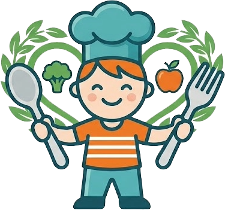

<div align="center">

<a href="https://dinnerkids.es">
  
</a>

# 🍽️ DinnerKids

**Planifica en segundos las cenas de los peques según lo que comen al mediodía en el colegio.**  
Gratis · Sin registro · Sin anuncios · Sin cookies · Tus datos no salen de tu móvil.

<p>
  <a href="https://dinnerkids.es"></a>&nbsp;
  <a href="https://github.com/ortisiano/dinnerkids/actions/workflows/ci.yml"></a>&nbsp;
  <a href="https://dinnerkids.es/privacidad.html"></a>
</p>

</div>

---

## ✨ Qué hace DinnerKids

1. **⚡ Modo Gratis Instantáneo (100 % en tu navegador, coste 0 € de IA):**
   - Cruza el menú escolar del mediodía con el catálogo de **108 recetas infantiles paso a paso** (`logic.js` / `recetas.json`).
   - Si en el cole comieron pasta o legumbres con pollo, por la noche propone pescado, huevo o verdura para no repetir plato ni grupo nutricional.
   - Respeta alérgenos (Sin Gluten, Sin Lactosa, Sin Huevo, Sin Pescado, Sin Frutos Secos, Sin Sésamo), gustos/ingredientes a evitar, tiempo máximo de cocina y rutinas fijas (*"viernes pizza, jueves pescado"*).
   - Incluye **Buscador de Nevera gratuito** en cada cena para cambiar el plato al instante según los ingredientes que tengas en casa.
2. **📲 Compartir el menú del cole por WhatsApp:**
   - Un padre o madre carga el menú de su colegio y pulsa **"Compartir menú de mi cole por WhatsApp"**.
   - Genera un enlace directo (`#cole=...`) sin datos personales para que todas las familias de la clase tengan el menú cargado en un toque.
3. **🛒 Lista de la compra semanal automática:**
   - Agrupa los ingredientes por semana o mes completo, permite ir tachándolos en el supermercado y copiarlos para WhatsApp.
4. **☕ Modo IA Opcional (Claude Haiku Vision) o tu propio Token (BYOK):**
   - DinnerKids es libre y gratuito para todo el mundo. Si además quieres usar la IA integrada del proyecto (lectura automática de fotos/PDF del menú del cole con Claude Vision + menús y recetas a medida), puedes apoyar el proyecto en [Ko-fi](https://ko-fi.com/ortisiano) o [GitHub Sponsors](https://github.com/sponsors/ortisiano), o configurar gratis tu propia clave de API en tu navegador.

---

## 🌿 Cómo colaborar (`development` → PR → `main`)

¡Las contribuciones (nuevas recetas infantiles, mejoras en el analizador de menús o correcciones) son bienvenidas! Consulta la guía completa en [**CONTRIBUTING.md**](CONTRIBUTING.md).

- **`main` (Producción):** Código estable desplegado automáticamente en [`dinnerkids.es`](https://dinnerkids.es). Protegido: solo acepta cambios mediante **Pull Request** aprobada.
- **`development` (Desarrollo):** Rama activa donde trabajamos y probamos todas las mejoras antes de pasarlas a `main`.

```bash
# Clonar y trabajar sobre la rama de desarrollo
git clone https://github.com/ortisiano/dinnerkids.git
cd dinnerkids
git checkout development

# Comprobar sintaxis y ejecutar la suite de tests automatizados
npm run check
npm test
```

---

## 🛠️ Comandos de desarrollo

```bash
npm run check                                                   # Comprobar sintaxis JS
npm test                                                        # Ejecutar tests automatizados (node:test)
PRO_CODE_SECRET="tu_secreto" npm run gen-code -- DK02 202706    # Generar 1 código individual Pro
```
